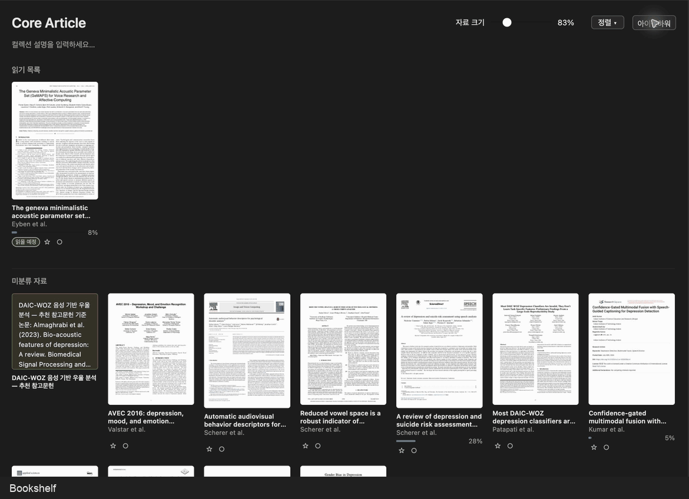
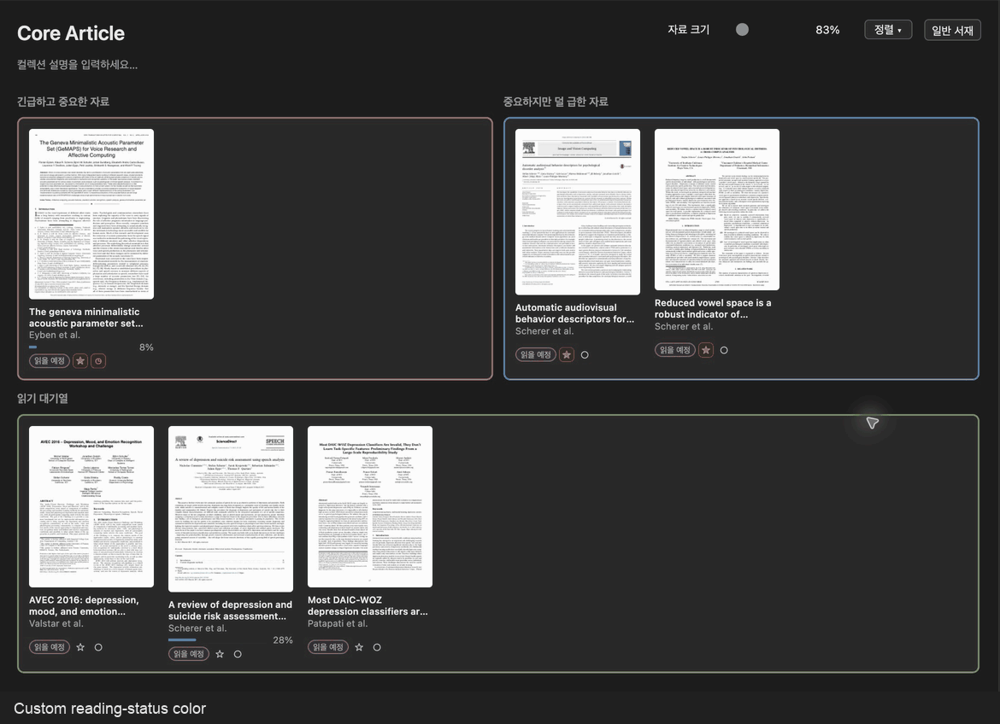

<p align="center">
  
</p>
<h1 align="center">Reading Shelf</h1>
<p align="center">
  <a href="https://github.com/4season/zotero-reading-shelf/releases/latest"></a>
  <a href="https://github.com/4season/zotero-reading-shelf/releases/tag/v1.2.1"></a>
  <a href="https://www.zotero.org/"></a>
  <a href="LICENSE"></a>
  <a href="https://github.com/4season/zotero-reading-shelf/actions/workflows/ci.yml"></a>
</p>
<p align="center"><a href="README.md">English</a> · <strong>한국어</strong></p>

Zotero 컬렉션을 위한 일반 서재·아이젠하워 읽기 도구입니다. 첨부파일 프리뷰를 보며 읽기 순서를 정하고, Markdown·LaTeX 메모와 읽기 상태를 함께 관리합니다.

## 설치

릴리즈의 XPI를 **도구 → 플러그인 → ⚙ → 파일에서 플러그인 설치**로 설치합니다. 컬렉션을 선택하고 **갤러리**를 누르면 서재가 열리며 **테이블**로 원래 목록에 돌아갑니다. 1.2.1부터 GitHub Releases를 통한 Zotero 자동 업데이트를 지원합니다. 1.2.0 이하에서는 새 업데이트 주소를 받기 위해 1.2.1을 한 번 수동 설치해야 합니다.

Zotero 10.x 대상이며 기존 Syllabus Lite/Reading Shelf 설정은 같은 플러그인 ID로 유지됩니다. 다른 갤러리 플러그인과 화면이 겹치면 한쪽 갤러리를 끄세요.

## 주요 기능

### 일반 서재·상태·읽기 순서



일반 서재는 읽기 목록·미분류·완료됨 영역을 나눕니다. 완료한 자료의 중요도·긴급도는 유지하며, 다시 읽기 영역에 넣으면 읽을 예정으로 돌아갑니다. 드래그나 선택적으로 표시하는 +/− 버튼으로 순서를 정합니다. 읽기 상태를 해제하면 저장된 읽기 목록에서도 빠지며 중요도·긴급도는 유지합니다. 테이블에서도 상태 목록과 별·파이/시계 버튼을 사용할 수 있습니다. 상태는 **상태 없음 / 읽을 예정 / 읽는 중 / 완료됨**, 별은 **중요도**, 파이/시계는 **긴급도**입니다.

컬렉션 메모를 더블클릭해 Markdown·LaTeX를 편집합니다. `$…$`, `\(…\)`는 인라인 수식, 별도 줄의 `$$…$$`, `\[…\]`는 독립 수식입니다. Ctrl/Cmd+Enter로 저장하고 Escape로 취소합니다. 긴 메모와 입력창은 내용에 맞춰 커지며, 100,000자 초과 원문은 처리 비용을 줄이기 위해 일반 텍스트로 표시합니다.

### 아이젠하워 분류

위쪽 두 영역에서 긴급하고 중요한 자료와 중요하지만 덜 급한 자료를 나누고, 아래에는 읽기 대기열을 둡니다. 제목은 박스 위에 표시되며 가로·세로 간격을 통일했습니다. 화면의 모드 버튼으로 일반 서재로 전환하고, **컬렉션별 모드 기억**을 켜면 각 컬렉션의 선택을 따로 보존합니다.

### 읽기·디자인 옵션



GIF는 Zotero 10.0.8의 Core Article 컬렉션에서 촬영하고 갤러리 영역만 잘랐습니다.

- Zotero 내장 리더로 열면 읽는 중으로 표시합니다. **마지막 자료 탭 종료 시 상태 해제**를 선택할 수 있으며 중요도·긴급도는 바꾸지 않습니다. 기본값은 꺼짐이고 외부 앱은 추적하지 않습니다.
- **컬렉션별 아이젠하워/일반 서재 모드 기억**은 기본적으로 꺼져 있습니다. 꺼도 기존 개별 저장값은 지우지 않습니다.
- 카드 크기·정렬·선택적 버튼 표시와 빈 상태 숨기기를 조절합니다. 모드 전환 버튼은 정렬 오른쪽에 있으며 따로 숨길 수 있습니다.
- 읽을 예정·읽는 중·완료됨 상태 색상과 중요도·긴급도 버튼 색상을 각각 지정합니다. 색상 선택기나 `#RRGGBB` 직접 입력을 사용하고, 그룹별·전체 초기화가 가능합니다. 아이젠하워 박스 테두리는 별도 소그룹으로 구분합니다.
- 그림자는 프리뷰에만 적용하며 강도·다크 모드 사용을 선택합니다. 행렬 테두리 색상을 바꾸거나 끌 수 있습니다. 하위 설정은 부모 옵션에 따라 비활성화되며 값은 보존됩니다.
- 관련 노트·첨부파일과 Zotero 기본 우클릭 메뉴를 지원하며 더블클릭으로 엽니다.

## 저장·호환성

읽기 순서·컬렉션 메모·모드·상태는 로컬 Zotero 설정에 저장되며 플러그인 자체가 동기화하지 않습니다. 프리뷰 캐시는 Zotero 데이터 폴더의 `syllabus-lite-thumbnails`에 저장합니다. 자료 파일을 외부로 업로드하지 않습니다.

**Windows·macOS·Linux 자동 테스트 및 XPI 빌드**를 통과했습니다. macOS에서는 설치된 Zotero PDF.js도 검증했습니다. 실제 Zotero 10.0.8에서 모드·중요도·긴급도 조작, 모드 숨김, 색상 반영·초기화를 확인했습니다. 브라우저에서 여러 줄 메모·Markdown·MathML·레이아웃·상태 조작을 확인했지만, 세 운영체제의 **설치된 Zotero UI**를 모두 실행한 검증은 아닙니다. Windows/Linux 실제 UI, RAM·프레임 시간은 미검증이며 이 범위를 명시해 정식 공개합니다.

PDF.js·EPUB·이미지 프리뷰는 호스트 API를 사용합니다. Quick Look과 Homebrew/MacPorts Poppler 보조 경로는 macOS에서만 실행합니다. 암호화되거나 지원하지 않는 문서의 프리뷰는 운영체제에 따라 다를 수 있으며 외부 프로그램을 자동 설치하지 않습니다.

## 빌드·검증

Python 3와 Node.js가 필요합니다. 실행 라이브러리는 소스에 포함되어 있으며 npm 실행 의존성이나 폴링 서비스를 추가하지 않습니다.

```sh
python scripts/test.py
python scripts/build.py
```

빌드 결과는 `dist/`에 저장됩니다. macOS에서 설치된 Zotero의 PDF.js를 함께 검증하려면 다음 명령을 실행합니다.

```sh
python scripts/test.py --zotero-omni /Applications/Zotero.app/Contents/Resources/app/omni.ja
```

`python -m http.server 8767` 실행 후 `http://127.0.0.1:8767/tests/layout.html`에서 브라우저 회귀 검증을 확인합니다. 기능 화면은 같은 서버의 `docs/demo.html?lang=ko&mode=matrix` 또는 `docs/demo.html?lang=en&mode=shelf`에서 확인할 수 있습니다.

## 라이선스·참고 플러그인

Reading Shelf는 **AGPL-3.0-only**입니다. 라이선스 원문·출처·수정 고지·의존성 고지와 XPI에 대응하는 소스를 함께 제공합니다. 주요 참고 플러그인은 다음과 같습니다.

| 프로젝트 | 라이선스 | 참고 범위 |
| --- | --- | --- |
| [Zotero Syllabus](https://github.com/janbaykara/zotero-syllabus) — Jan Baykara 및 기여자 | [AGPLv3](https://github.com/janbaykara/zotero-syllabus/blob/main/LICENSE) | 갤러리 기반 구현과 읽기 순서 노트 형식 |
| [ZoteroThumbLibrary](https://github.com/gchapron/ZoteroThumbLibrary) — Guillaume Chapron | [AGPLv3](https://github.com/gchapron/ZoteroThumbLibrary/blob/main/LICENSE) | 표지 탐색·카드 크기·갤러리 사용성 |
| [Zotero](https://github.com/zotero/zotero) — 실행 호스트 | [AGPLv3](https://github.com/zotero/zotero/blob/main/COPYING) | 호스트 API와 PDF.js 사용 |

주요 참고 플러그인은 **실라버스와 ZoteroThumbLibrary**입니다. 2026-11-07에 두 플러그인의 LICENSE와 Zotero의 COPYING 원문을 확인했습니다. MIT 라이브러리 고지를 보존했으며 `vendor/upstream/`은 대응 의존성 소스이므로 유지합니다. 자세한 원본 식별자와 출처는 [NOTICE.md](NOTICE.md)에 기록했습니다.

## 새 버전 업데이트 배포

`scripts/build.py`가 XPI·SHA-256·`updates.json`을 만듭니다. GitHub Release에 XPI를 먼저 게시한 뒤 생성된 `updates.json`을 저장소 루트에 반영합니다. 버전별 다운로드 주소·호환 범위·XPI 해시는 `tests/updates.py`에서 검증합니다. 별도 서버 없이 정식 버전을 제공하며, Zotero의 플러그인 자동 업데이트가 켜져 있어야 합니다.
