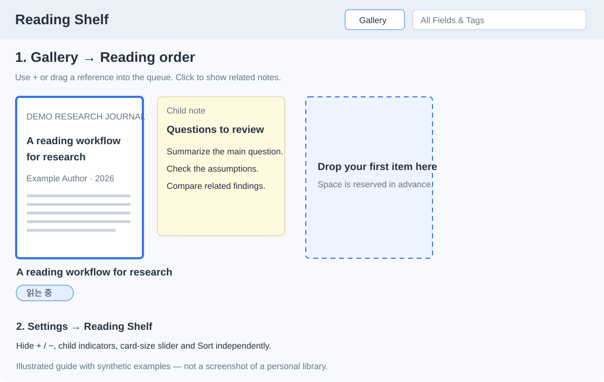
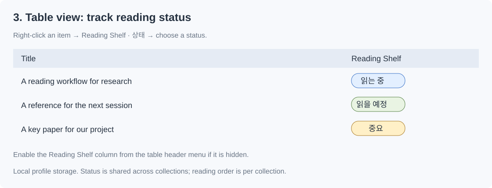

# Reading Shelf

Reading Shelf is an independent third-party plugin compatible with Zotero. It adds a gallery for Zotero collections. Browse covers, put papers and books in reading order, and open their notes and attachments from the gallery.

## Install

1. Download `zotero-reading-shelf-1.2.0-beta.3.xpi` from the GitHub release.
2. In Zotero, open **Tools → Plugins → ⚙ → Install Plugin From File…** and select the XPI.
3. Select one collection and click **Gallery**. Click **Table** to return to the Zotero table.

The manifest targets Zotero 10.x. Development and interactive feedback used Zotero 10.0.7 on macOS. Other operating systems have yet to be tested. Quick Look and the optional Poppler fallback are macOS-specific. Updates are installed manually.

If you already use the earlier Syllabus Lite build, install over it. Reading Shelf keeps the same plugin ID and preferences. If you use the original Zotero Syllabus, switch off its gallery before opening Reading Shelf to avoid overlapping gallery controls.

## Use the gallery

- Drag cards into **Reading order**, or use the card's **+** button. Drag between cards to reorder them.
- Click a card to select it and show any additional child notes or attachments. Double-click to open a file or note. Right-click an item for Zotero's item menu.
- Resize cards with **Card size**. Use **Sort** to sort unordered items without changing the custom reading order.
- Double-click the collection description to edit Markdown or add LaTeX. Use `$…$` within a sentence and put `$$…$$` on a separate line for an equation.
- On macOS, choose **Zotero → Settings → Reading Shelf** to hide card buttons, the size slider, or the sort menu.

## Reading status and illustrated guide



The **Gallery / Table** toggle sits immediately to the right of quick search and uses a compact toolbar size. Notes show a text excerpt in a readable note card. Dragging the first item into an empty **Reading order** reserves a card-sized space before you drop it.

Set **읽을 예정** (to read) or **읽는 중** (reading) using the status selector, or right-click one or more items and choose **Reading Shelf → Reading status**. Importance (★) and urgency (clock) are separate switches. Clearing the reading status keeps those switches unchanged. The beta.1 combined “important” status is preserved as importance when migrated.



The table's **Reading Shelf** column shows reading status and priority badges. Enable it through the table header's column picker if necessary. The **Info** pane includes a read-only Reading Shelf workflow row for bibliographic items. Attached files share their parent reference's status. Native reader opening and tab selection mark the reference as reading, including opening from the table. External applications opened outside Zotero's reader cannot be observed reliably.

Status, importance and urgency are local to this Zotero profile and shared across collections for the same reference. No tags, Extra fields or bibliographic metadata are changed. An item in an existing local reading order defaults to “to read” until explicitly changed. Queue membership alone is not a measurement of reading completion.

In **Settings → Reading Shelf**:

- Choose **한국어 / English** for the plugin interface.
- Hide empty statuses by default; hovering or keyboard focus reveals the selector. Existing status badges stay visible.
- Hide reading-order **+ / −**, child indicators, the size slider and Sort independently.
- Choose preview shadow strength (**Off / Soft / Medium / Strong**). Dark-mode shadows are off by default and have a separate opt-in.
- Pick individual border colors for the urgent, important and queue **regions**. Colors apply immediately.
- Enable the **Eisenhower 1 × 2 mode**: urgent and important references on the left, important but less urgent references on the right; a full-width second row holds queued references without importance, and other items remain below. Use star/clock switches or drag into a lane to classify. Dragging into a lane also adds the item to the reading queue. Removing queue membership does not clear importance.

These illustrations are diagrams using synthetic examples, not captured Zotero screenshots. `docs/demo.html` is a browser fixture, not the installed Zotero interface.

## Platform and performance boundaries

PDF.js, EPUB covers and local image previews use Zotero/Gecko APIs on all targeted desktop platforms. Quick Look and fixed Homebrew/MacPorts Poppler paths are guarded by `Zotero.isMac`; those optional fallbacks are not invoked on Windows or Linux. Unsupported documents may therefore have different preview availability on different systems. No external tools are installed by the plugin.

Animation measurements are batched before animation writes, thumbnail work remains bounded and cancellable, and the small light-mode shadow is static. Reduced-motion preferences are respected. Automated fixtures pass on macOS; the new interface and actual Windows/Linux execution still need interactive testing. No total-RAM or frame-time benchmark is claimed.

## Storage and previews

Reading order and collection descriptions are stored in local Zotero preferences. For a collection without local Reading Shelf data, the plugin can read the original Syllabus personal reading order note as a starting point. Subsequent edits are stored in Reading Shelf's preferences and are local to the profile.

Long collection descriptions scroll inside a bounded text area; double-click or use **Edit description** to edit. Descriptions above 100,000 characters display as plain text to avoid expensive Markdown rendering; the complete source remains editable and saved.

The gallery generates thumbnails for local attachments near the viewport and stores them in the `syllabus-lite-thumbnails` subfolder of the Zotero data directory. The preview pipeline uses Zotero's bundled PDF.js, embedded EPUB covers, local images, and optional local preview tools on macOS. Missing, encrypted, and unsupported attachments may show placeholders. The plugin uses local files for preview generation.

## Build and test

Python 3 and Node.js are required for these commands. The build uses vendored browser libraries and Python's standard library.

```sh
python3 scripts/build.py
python3 scripts/test.py
```

The build writes the XPI and its SHA-256 checksum to `dist/`. To test bounded PDF reads and cancellation with Zotero's own PDF.js and a synthetic PDF fixture on macOS, run the optional integration test.

```sh
python3 scripts/test.py --zotero-omni /Applications/Zotero.app/Contents/Resources/app/omni.ja
```

The automated tests exercise gallery logic and PDF handling. They do not launch the Zotero interface or measure its total memory use.

## License and credits

This project is distributed under [AGPL-3.0](LICENSE). See [NOTICE.md](NOTICE.md) for Zotero Syllabus attribution and bundled library notices.
