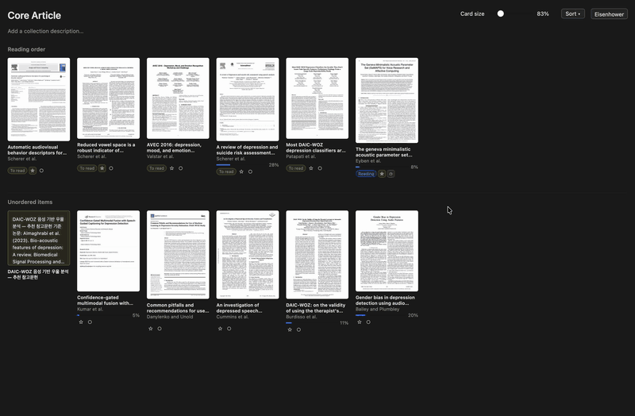
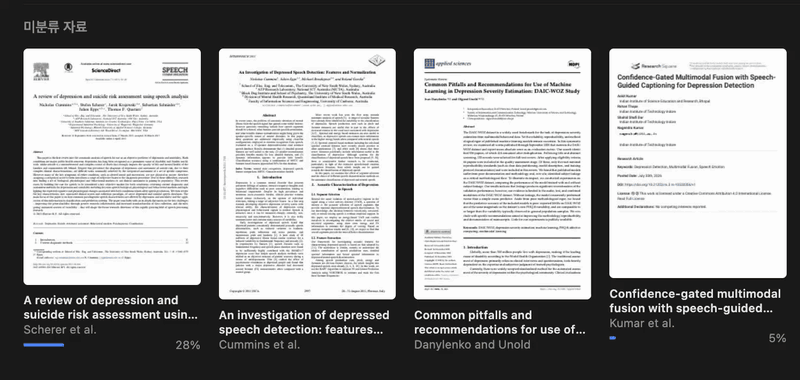
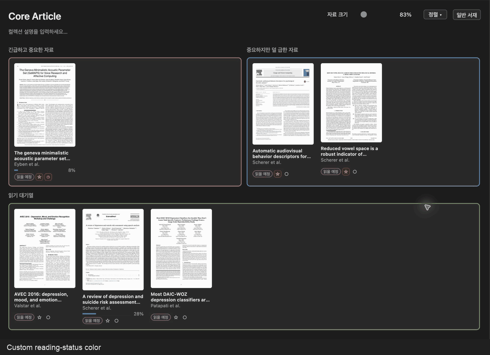

  

<h1 align="center">Reading Shelf</h1>

  
  
  
  
  

<strong>English</strong> · <a href="README.ko.md">한국어</a>

Reading Shelf turns a Zotero collection into a bookshelf. See each paper's preview, put papers in the order you plan to read them, track what you are reading, and sort them with an Eisenhower (urgent/important) layout. Everything stays inside Zotero.

## Install

1. Download `zotero-reading-shelf-1.3.8.xpi` from the [latest release](https://github.com/4season/zotero-reading-shelf/releases/latest).
2. In Zotero, choose **Tools → Plugins → ⚙ → Install Plugin From File…** and select the file.
3. Select a collection and click **Gallery**. Click **Table** to go back to the normal list.

Requires Zotero 10.x. Your settings from earlier versions are kept.

**Updating:** Zotero can update the plugin automatically if automatic plugin updates are turned on. **Coming from 1.2.x?** Version 1.3.0 has a new add-on ID, so it is not offered as an automatic update. Remove the old Reading Shelf in **Tools → Plugins**, then install 1.3.0 as above. Your settings, statuses, reading order and notes are carried over.

**Language:** The plugin starts in Korean. To switch to English, open Zotero's settings, choose **Reading Shelf**, and set **Language** to English.

If another gallery plugin is installed and the two overlap, turn one of them off.

## What you can do

### Arrange your reading list

- **Bookshelf:** papers you plan to read or are reading appear first, in your order. Other papers appear under *Unordered items*, and finished ones under *Completed*.
- **Reorder:** drag a card, or use the + / − button on the card. With the − button focused (Tab to it), Alt + ←/→ moves the card.
- **Reading progress:** PDF cards show a progress bar based on the last page you read.
- **Reading status:** *No status*, *To read*, *Reading* or *Completed*. Change it from the card or from the status column in the table. Clearing the status removes the paper from your reading list.
- **Importance and urgency:** ★ marks importance and ◷ marks urgency. They are separate from status, so they stay as they are when you change a paper's status. A ★ or ◷ that is off appears only when you hover over the card (or focus it with the keyboard); one that is on always stays visible. You can turn this off in the settings. Standalone notes and files in a collection get ★ and ◷ too (but no reading status), so they can be placed in the Eisenhower lanes like papers.
- Putting a paper in the reading list sets it to *To read* (a paper already marked *Reading* stays that way). Moving it to *Unordered items* clears its status. Moving a *Completed* paper back to the reading list sets it to *To read*.
- Opening a paper in Zotero's own reader marks it *Reading*. Optionally, the status can be cleared when you close its last reader tab (off by default; PDF readers outside Zotero are not detected).

### Eisenhower layout

Use the mode button next to **Sort** to switch the bookshelf to an Eisenhower layout: *Urgent & important* and *Important, not urgent* sit side by side, with the *Reading queue* below. Drag papers between them. Switch the same button back to return to the bookshelf.

By default the layout you pick applies to all collections. To remember a separate layout for each collection, turn on **Remember Eisenhower / bookshelf mode per collection** in the settings. The **Eisenhower mode** checkbox in the settings always shows the same mode as the mode button; with per-collection memory on, it applies to the collection selected in Zotero.

### See notes and attachments at a glance

Click a paper that has notes or more than one attachment and they fan out as cards right beside it, with previews, so you can see what is attached without opening anything. Right-click any card, including these child cards, for Zotero's usual context menu (open in a new tab or window, show in Finder or in the library, and more). Double-click to open an attachment or note. Click an empty area to fold them away again. The opened paper follows you when you switch between **Gallery** and **Table**: open in one, and it is open in the other too, and closing it in one closes it in the other.

### Collection notes

Double-click the note at the top of a collection to edit it. Markdown and LaTeX are supported:

- Inline math: `$…$` or `\(…\)`
- Equations on their own lines: `$$…$$` or `\[…\]`
- Save with Ctrl/Cmd + Enter; cancel with Esc.

Notes longer than 100,000 characters are shown as plain text so Zotero stays responsive; the text itself is never changed.

### Customize

Open Zotero's settings and choose **Reading Shelf** to:

- change card size, sorting, and which buttons and controls are shown (including the mode button);
- set colors for *To read*, *Reading* and *Completed*, the ★ and ◷ buttons, and the Eisenhower borders, by color picker or `#RRGGBB` code, and reset one group or all colors;
- adjust preview shadows (off, soft, medium, strong; dark mode optional).

Settings that depend on another option are greyed out but keep their values.

## Your data and privacy

- Reading order, collection notes, modes and statuses are saved on your computer in Zotero's preferences. This plugin does not sync them to other computers.
- Preview images are cached in a `reading-shelf-thumbnails` folder inside your Zotero data folder. They can be deleted at any time and are regenerated as needed. Earlier versions used a folder named `syllabus-lite-thumbnails`, which is no longer used and can be deleted.
- Your files are never uploaded anywhere.

## Known limits

- Tested on macOS with Zotero 10.0.8. Windows and Linux have not been tried with the installed Zotero app.
- Previews work for PDFs, EPUBs and images. Encrypted or unsupported files may show no preview. On macOS, Quick Look (and Poppler, if you have installed it) is used as a fallback.

## License and credits

Reading Shelf is free software under **AGPL-3.0-only**. It builds on [Zotero Syllabus](https://github.com/janbaykara/zotero-syllabus) by Jan Baykara and contributors, and was inspired by [ZoteroThumbLibrary](https://github.com/gchapron/ZoteroThumbLibrary) by Guillaume Chapron; both are AGPLv3. Bundled markdown-it and KaTeX are MIT-licensed. See [NOTICE.md](NOTICE.md) for details.

Reading Shelf is an independent plugin and is not affiliated with Zotero. Zotero is a registered trademark of the Corporation for Digital Scholarship.

Developers: see [CONTRIBUTING.md](CONTRIBUTING.md) for building, testing and releasing.
