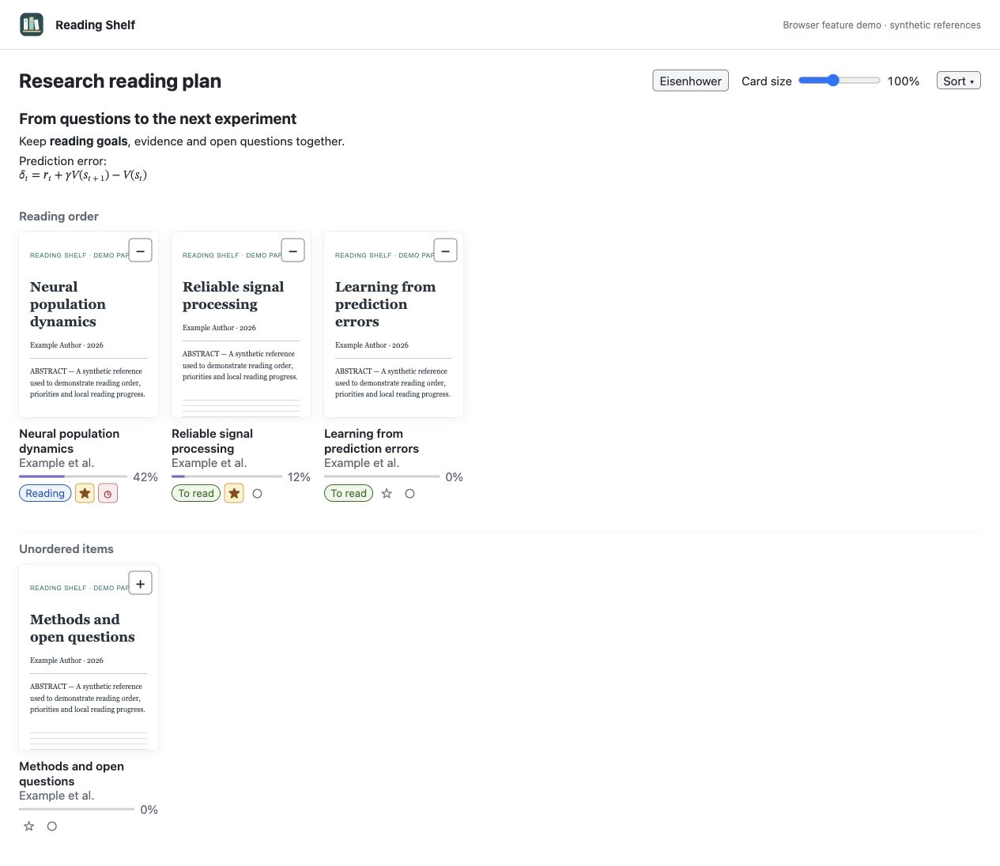
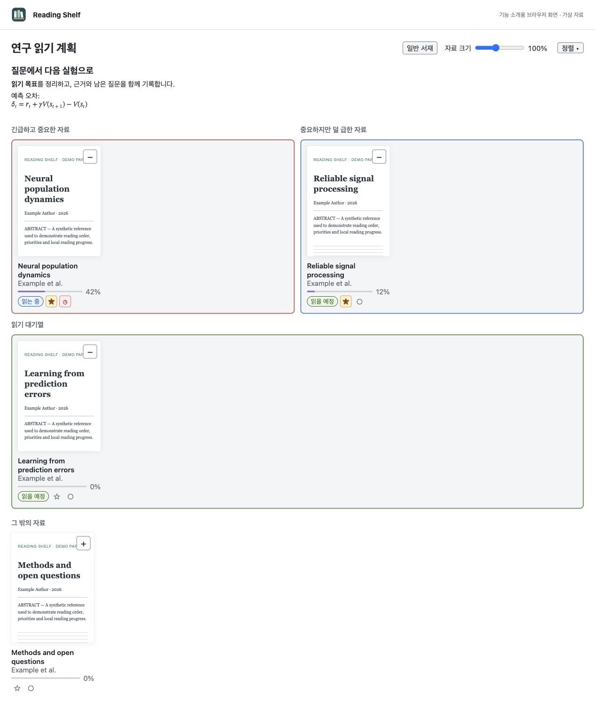

# Zotero Reading Shelf

A local bookshelf and Eisenhower reading planner for Zotero collections. Browse attachment previews, arrange reading order, keep Markdown/LaTeX collection notes and change reading status without leaving the library.

Zotero 컬렉션을 위한 일반 서재·아이젠하워 읽기 도구입니다. 첨부파일 프리뷰를 보며 읽기 순서를 정하고, Markdown·LaTeX 메모와 읽기 상태를 함께 관리합니다.

## Install / 설치

Download `zotero-reading-shelf-1.2.0.xpi` from [Releases](https://github.com/4season/zotero-reading-shelf/releases/tag/v1.2.0). In Zotero, choose **Tools → Plugins → ⚙ → Install Plugin From File…**. Select a collection and click **Gallery**. Click **Table** to return to the native table. Updates are manual.

릴리즈의 XPI를 **도구 → 플러그인 → ⚙ → 파일에서 플러그인 설치**로 설치합니다. 컬렉션을 선택하고 **갤러리**를 누르면 서재가 열리며 **테이블**로 원래 목록에 돌아갑니다. 업데이트는 수동 설치 방식입니다.

Targets Zotero 10.x; existing Syllabus Lite/Reading Shelf preferences retain the same add-on ID. Switch off other gallery plugins when their controls overlap.

Zotero 10.x 대상이며 기존 Syllabus Lite/Reading Shelf 설정은 같은 플러그인 ID로 유지됩니다. 다른 갤러리 플러그인과 화면이 겹치면 한쪽 갤러리를 끄세요.

## Features / 주요 기능

### Bookshelf, status and reading order / 일반 서재·상태·읽기 순서



The bookshelf groups queued or actively reading references above unordered items. Drag cards to reorder, or use the optional +/− buttons. Clearing reading status removes the reference from saved reading queues while retaining importance and urgency. Table status labels use native menus; star and pie/clock controls toggle importance and urgency independently. Clicking outside a status control releases its focus.

일반 서재는 읽기 목록과 미분류 자료를 나눕니다. 드래그나 선택적으로 표시하는 +/− 버튼으로 순서를 정합니다. 읽기 상태를 해제하면 저장된 읽기 목록에서도 빠지며 중요도·긴급도는 유지합니다. 테이블에서도 상태 목록과 별·파이/시계 버튼을 사용할 수 있습니다. 상태는 **상태 없음 / 읽을 예정 / 읽는 중**, 별은 **중요도**, 파이/시계는 **긴급도**입니다.

Double-click a collection note to edit Markdown and LaTeX. Use `$…$` or `\(…\)` inline, and separate `$$…$$` or `\[…\]` blocks for equations. Save with Ctrl/Cmd+Enter; cancel with Escape. Long notes and the editor grow with content. Very large sources above 100,000 characters display as plain text while preserving the original source.

컬렉션 메모를 더블클릭해 Markdown·LaTeX를 편집합니다. `$…$`, `\(…\)`는 인라인 수식, 별도 줄의 `$$…$$`, `\[…\]`는 독립 수식입니다. Ctrl/Cmd+Enter로 저장하고 Escape로 취소합니다. 긴 메모와 입력창은 내용에 맞춰 커지며, 100,000자 초과 원문은 처리 비용을 줄이기 위해 일반 텍스트로 표시합니다.

### Eisenhower planner / 아이젠하워 분류



Put urgent/important and important/not-urgent references in two top lanes, with a full-width reading queue below. Labels sit above the boxes; horizontal and vertical gaps match. Use the gallery's mode switch to return to a normal bookshelf. Enable **Remember mode per collection** to keep separate modes; otherwise the global mode applies.

위쪽 두 영역에서 긴급하고 중요한 자료와 중요하지만 덜 급한 자료를 나누고, 아래에는 읽기 대기열을 둡니다. 제목은 박스 위에 표시되며 가로·세로 간격을 통일했습니다. 화면의 모드 버튼으로 일반 서재로 전환하고, **컬렉션별 모드 기억**을 켜면 각 컬렉션의 선택을 따로 보존합니다.

**Screenshot scope:** these are browser screenshots of the production gallery code with synthetic references, not screenshots of an installed Zotero library. No personal library or paper files are included.

**사진 범위:** 실제 갤러리 코드와 가상 자료를 사용한 브라우저 스크린샷입니다. 설치된 Zotero 라이브러리 자체를 촬영한 화면은 아니며 개인 자료는 포함하지 않았습니다.

### Reader and appearance options / 읽기·디자인 옵션

- Native Zotero reader opening marks the reference as Reading. Optionally clear that status when its last tracked reader tab closes; keep importance and urgency. The option is off by default. External applications are not tracked.
- Optionally remember bookshelf/Eisenhower mode per collection. This is off by default; disabling it retains stored per-collection choices for later reuse.
- Resize cards, sort unordered items and hide optional controls. Empty status labels remain hidden until hover or keyboard access.
- Choose preview-only shadow strength; dark-mode shadows are opt-in. Set lane border colors or turn borders off. Dependent settings disable without clearing saved values.
- Click cards to select; open related child notes/attachments and use Zotero's native context menu. Double-click to open a reference's attachment or note.

- Zotero 내장 리더로 열면 읽는 중으로 표시합니다. **마지막 자료 탭 종료 시 상태 해제**를 선택할 수 있으며 중요도·긴급도는 바꾸지 않습니다. 기본값은 꺼짐이고 외부 앱은 추적하지 않습니다.
- **컬렉션별 아이젠하워/일반 서재 모드 기억**은 기본적으로 꺼져 있습니다. 꺼도 기존 개별 저장값은 지우지 않습니다.
- 카드 크기·정렬·선택적 버튼 표시와 빈 상태 숨기기를 조절합니다.
- 그림자는 프리뷰에만 적용하며 강도·다크 모드 사용을 선택합니다. 행렬 테두리 색상을 바꾸거나 끌 수 있습니다. 하위 설정은 부모 옵션에 따라 비활성화되며 값은 보존됩니다.
- 관련 노트·첨부파일과 Zotero 기본 우클릭 메뉴를 지원하며 더블클릭으로 엽니다.

## Storage and platform coverage / 저장·호환성

Reading order, collection notes, modes and workflow state are local Zotero preferences; they are not synced by this plugin. Thumbnail cache files are stored under `syllabus-lite-thumbnails` in the Zotero data directory. The plugin does not upload reference files.

읽기 순서·컬렉션 메모·모드·상태는 로컬 Zotero 설정에 저장되며 플러그인 자체가 동기화하지 않습니다. 프리뷰 캐시는 Zotero 데이터 폴더의 `syllabus-lite-thumbnails`에 저장합니다. 자료 파일을 외부로 업로드하지 않습니다.

Portable tests and XPI builds passed on **Windows, macOS and Linux** in [GitHub Actions](https://github.com/4season/zotero-reading-shelf/actions). macOS also passed tests with Zotero 10.0.7's PDF.js. Browser checks cover multiline XML-host notes, Markdown/MathML, layout and status interactions. These tests do **not** launch the installed Zotero UI on all three systems. Windows/Linux native UI, RAM and frame-time measurements remain unverified. This release is published with that coverage boundary explicitly disclosed.

**Windows·macOS·Linux 자동 테스트 및 XPI 빌드**를 통과했습니다. macOS에서는 Zotero 10.0.7 PDF.js도 검증했습니다. 브라우저에서 여러 줄 메모·Markdown·MathML·레이아웃·상태 조작을 확인했지만, 세 운영체제의 **설치된 Zotero UI**를 모두 실행한 검증은 아닙니다. Windows/Linux 실제 UI, RAM·프레임 시간은 미검증이며 이 범위를 명시해 정식 공개합니다.

PDF.js, EPUB and image previews use host APIs. Quick Look and optional Homebrew/MacPorts Poppler fallbacks are guarded by `Zotero.isMac`; Windows/Linux do not invoke those paths. Preview availability can differ for unsupported/encrypted documents. No external preview software is installed automatically.

## Build and test / 빌드·검증

Python 3 and Node.js are needed. Runtime libraries are vendored; the plugin adds no npm runtime dependency or polling service.

```sh
python scripts/test.py
python scripts/build.py
```

Build outputs go to `dist/`. Optional installed-Zotero PDF test on macOS:

```sh
python scripts/test.py --zotero-omni /Applications/Zotero.app/Contents/Resources/app/omni.ja
```

For a browser regression fixture, run `python -m http.server 8767` and open `http://127.0.0.1:8767/tests/layout.html`. For the feature screens, open `docs/demo.html?lang=ko&mode=matrix` or `docs/demo.html?lang=en&mode=shelf` through the same server.

## Licenses and reference plugins / 라이선스·참고 플러그인

Reading Shelf is **AGPL-3.0-only**. Full license text, attribution, modification notices, dependency notices and matching source accompany the XPI. The major reference plugins are explicitly:

| Project / 프로젝트 | License / 라이선스 | Relationship / 참고 범위 |
| --- | --- | --- |
| [Zotero Syllabus](https://github.com/janbaykara/zotero-syllabus) — Jan Baykara and contributors | [AGPLv3](https://github.com/janbaykara/zotero-syllabus/blob/main/LICENSE) | Gallery implementation lineage and personal reading-order note format / 갤러리 기반 구현과 읽기 순서 노트 형식 |
| [ZoteroThumbLibrary](https://github.com/gchapron/ZoteroThumbLibrary) — Guillaume Chapron | [AGPLv3](https://github.com/gchapron/ZoteroThumbLibrary/blob/main/LICENSE) | Cover browsing, card size and gallery usability reference / 표지 탐색·카드 크기·갤러리 사용성 참고 |
| [Zotero](https://github.com/zotero/zotero) — host application | [AGPLv3](https://github.com/zotero/zotero/blob/main/COPYING) | Host APIs and PDF.js supplied by Zotero / 실행 호스트 API와 PDF.js 사용 |

The two major reference plugins and Zotero's original license files were checked on 2026-11-07. Bundled markdown-it, KaTeX and their dependency notices remain MIT. `vendor/upstream/` contains matching dependency source archives, not user data or temporary files. See [NOTICE.md](NOTICE.md) for exact license blob identifiers and full provenance. Zotero is a registered trademark of the Corporation for Digital Scholarship; this is an independent third-party plugin with its own icon.

주요 참고 플러그인은 **실라버스와 ZoteroThumbLibrary**입니다. 2026-11-07에 두 플러그인의 LICENSE와 Zotero의 COPYING 원문을 확인했습니다. MIT 라이브러리 고지를 보존했으며 `vendor/upstream/`은 대응 의존성 소스이므로 유지합니다. 자세한 원본 식별자와 출처는 [NOTICE.md](NOTICE.md)에 기록했습니다.
