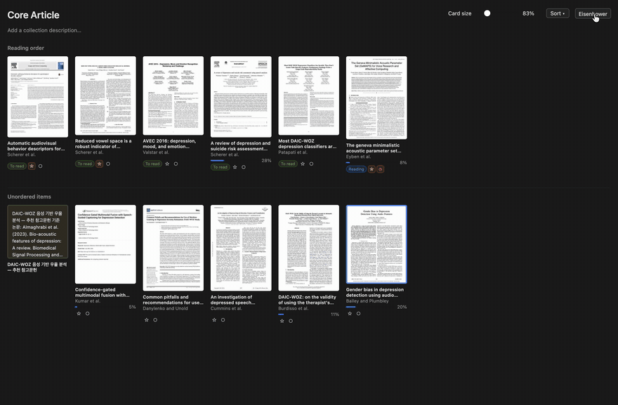

# Reading Shelf 1.3.0 — 플러그인 ID 변경 (재설치 필요)

[English](https://github.com/4season/zotero-reading-shelf/blob/main/RELEASE_NOTES.md) · **한국어**

## 1.2.x에서 업데이트할 때 필요한 작업

Reading Shelf가 참고한 플러그인에서 물려받은 ID 대신 자체 ID `reading-shelf@4season.github.io`를 쓰게 되었습니다. Zotero는 다른 플러그인으로 취급하므로 **자동 업데이트로는 안내되지 않습니다.**

1. Zotero의 **도구 → 플러그인**에서 기존 **Reading Shelf**를 제거합니다.
2. **⚙ → 파일에서 플러그인 설치…**로 **zotero-reading-shelf-1.3.0.xpi**를 설치하고, 안내가 나오면 재시작합니다.

두 버전을 함께 설치하지 마세요. 갤러리 버튼과 설정이 겹칩니다.

## 그대로 이어지는 것

설정, 읽기 상태, 중요도·긴급도, 읽기 순서, 컬렉션별 모드, 컬렉션 메모는 유지됩니다. 1.3.0은 처음 실행할 때 이전 버전이 저장한 설정을 새 이름(`extensions.reading-shelf.*`)으로 복사합니다(1.2.4부터 포함). 이미 저장된 값은 덮어쓰지 않고 이전 값도 그대로 남습니다. 미리보기 이미지는 처음 볼 때 다시 만듭니다.

## 이번 릴리즈에 함께 들어 있는 것

- 설정을 참고한 플러그인 이름 대신 Reading Shelf 이름(`extensions.reading-shelf.*`)으로 저장합니다.
- 미리보기는 `reading-shelf-thumbnails`에 저장합니다(1.2.3부터). 예전 `syllabus-lite-thumbnails` 폴더는 지워도 됩니다.

1.2.4는 업데이트로 안내된 적이 없으며, 1.3.0에 그 내용이 모두 들어 있습니다.

## 알려진 한계

macOS의 Zotero 10.0.8에서 확인했습니다. Windows·Linux의 설치된 Zotero 앱은 확인하지 못했습니다. 이전 설정을 이어받는 동작은 자동 테스트로 확인했으며, 다양한 실제 라이브러리에서는 아직 실행해 보지 못했습니다.

## 라이선스

AGPL-3.0-only입니다. [Zotero Syllabus](https://github.com/janbaykara/zotero-syllabus)를 바탕으로 만들고 [ZoteroThumbLibrary](https://github.com/gchapron/ZoteroThumbLibrary)를 참고했으며 둘 다 AGPLv3입니다. [NOTICE](https://github.com/4season/zotero-reading-shelf/blob/main/NOTICE.md)를 보세요.
