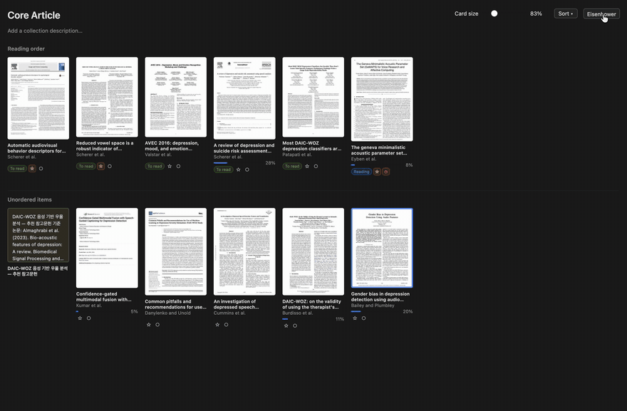

# Reading Shelf 1.3.5 — Faster reopening of notes and attachments

**English** · [한국어](https://github.com/4season/zotero-reading-shelf/blob/main/RELEASE_NOTES.ko.md)

## What's improved

- **Reopening a paper's notes and attachments is faster.** Previews and note excerpts that were already produced are reused instead of being read and built again every time. They are refreshed when the item changes.
- **Previews that could not be created are retried less often** (every 30 minutes instead of every 2). Encrypted or unsupported files no longer trigger repeated slow attempts while you browse.

## What's fixed

- **Cards no longer grow slightly when you open one.** Opening a card adds a row and can bring in the scrollbar, which used to narrow the gallery, drop a column and enlarge every card. The gallery now keeps room for the scrollbar so the width stays the same.

## Update

Same add-on ID as 1.3.0, so Zotero updates it automatically when automatic plugin updates are on. Coming from 1.2.x? Remove the old Reading Shelf in **Tools → Plugins** first, then install **zotero-reading-shelf-1.3.5.xpi** via **⚙ → Install Plugin From File…**.

## Known limits

Checked on macOS with Zotero 10.0.8. Windows and Linux with the installed Zotero app have not been checked. The card-size fix is based on a screen recording and could not be reproduced in the test browser; if cards still grow when you open one, please report it.

## License

AGPL-3.0-only. Built on [Zotero Syllabus](https://github.com/janbaykara/zotero-syllabus) and inspired by [ZoteroThumbLibrary](https://github.com/gchapron/ZoteroThumbLibrary), both AGPLv3. See [NOTICE](https://github.com/4season/zotero-reading-shelf/blob/main/NOTICE.md).
